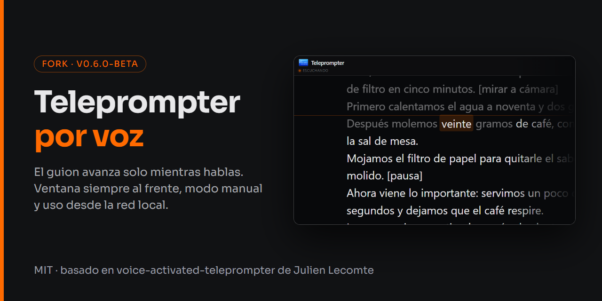
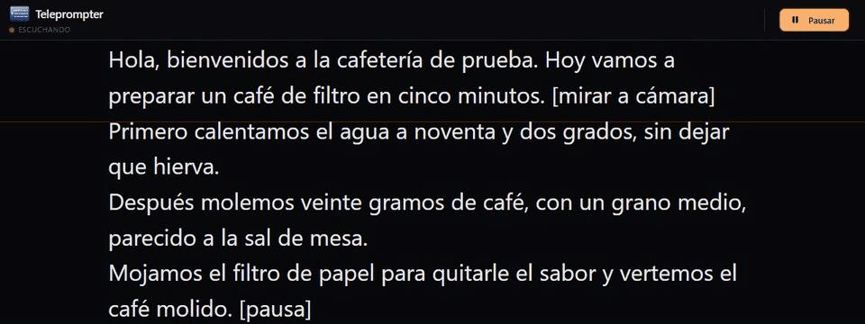
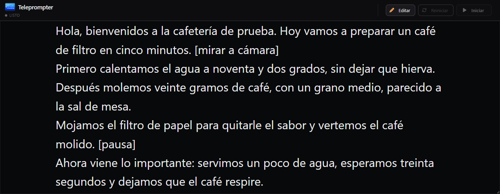
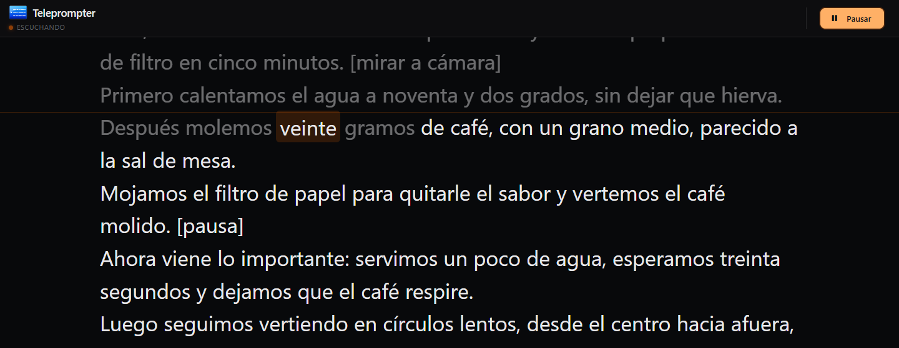
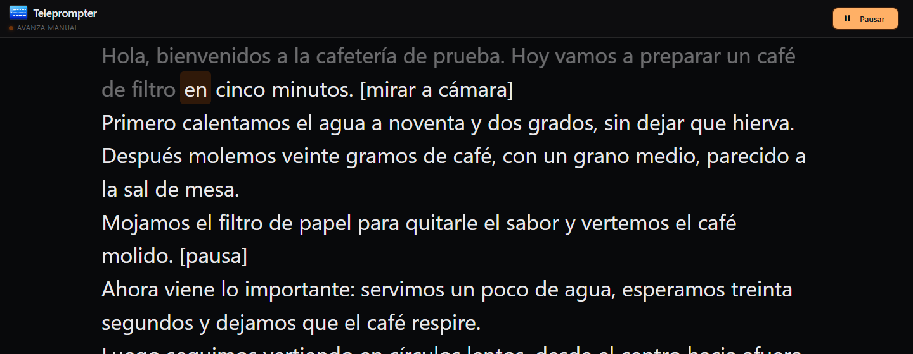

# Teleprompter por voz

> **Fork de [jlecomte/voice-activated-teleprompter](https://github.com/jlecomte/voice-activated-teleprompter) por Vector Digital — v0.6.0-beta, en construcción.**

El guion avanza solo mientras hablas: el navegador escucha, compara lo que dices con el texto y desplaza la lectura hasta tu palabra. Este fork le añade una ventana flotante siempre al frente para Windows, un modo manual a velocidad constante, un servidor local/LAN, un rediseño oscuro y la interfaz en español.

   



## El problema

Grabar a cámara leyendo un guion tiene dos malas salidas: un teleprompter de scroll fijo que te obliga a seguir su ritmo, o apps de pago con seguimiento de voz. El proyecto original de Julien Lecomte resuelve lo esencial (seguimiento por voz, robusto ante equivocaciones, gratis y en el navegador). Pero si grabas en tu propio PC, la ventana del guion acaba tapada por OBS o por la videollamada, y no hay plan B cuando el micrófono no está disponible.

## Qué añade este fork

Todo lo de esta lista está en el código de este repo y se probó en esta versión (ver «Qué se verificó»).

- **Modo burbuja (Windows):** `windows/burbuja.cmd` abre la app como ventana de Chrome/Edge sin barras (`--app`), con tamaño y posición propios, y la fija **siempre al frente** sin quitar el foco a la ventana en la que estés trabajando. Así la puedes poner justo debajo de la webcam.
- **Modo manual:** el texto avanza a velocidad constante (slider de 20 a 200; 50 ≈ 150 palabras por minuto), sin micrófono. Arranca desde la palabra en la que estés.
- **Servidor local/LAN:** `server/servidor.py` (solo biblioteca estándar de Python) sirve el build en `localhost` y, con `--lan`, también para otros equipos de la red. Muestra las direcciones a las que puedes entrar.
- **Palabra activa y línea guía:** la palabra que estás leyendo lleva una píldora naranja y una línea fina marca la altura de lectura.
- **Rediseño oscuro:** grises carbón y un único acento naranja, barra de una sola fila con sliders etiquetados (tamaño, margen, opacidad, línea, velocidad), botones con texto e indicador de estado (Listo / Escuchando / Avanza manual). Las barras de scroll están ocultas.
- **Español:** interfaz y guion de ejemplo en español; el reconocimiento usa `es-ES`.
- **Arreglos de build:** el upstream actual no compila (le falta `index.html`); este fork lo restaura, usa rutas relativas (`base: "./"`) y carga Font Awesome desde cdnjs en vez de un Kit personal.

Lo que **no** trae (ver Límites): selector de idioma ni modo espejo. Los quitamos de la barra y vuelven en la hoja de ruta.

## Demo



*GIF real de la app. Para poder grabarlo sin micrófono, el reconocedor de voz del navegador se sustituyó por uno simulado que «lee» el guion con dos errores a propósito («cinquenta», «parecida»). Todo lo demás es el motor real de la app: la coincidencia por distancia de Levenshtein, el resaltado y el scroll.*

| Modo edición | Modo lectura (voz) | Modo manual |
|---|---|---|
|  |  |  |

## Por qué es distinto

| | Este fork | Upstream (jlecomte) | Teleprompter web de scroll fijo | Apps de pago con voz |
|---|---|---|---|---|
| Sigue tu voz | Sí (motor del upstream) | Sí | No | Sí |
| Ventana siempre al frente | Sí (Windows) | No | No | Depende de la app |
| Modo sin micrófono | Sí, velocidad constante | No | Es su único modo | Normalmente sí |
| Uso desde otro equipo de la red | Sí (`--lan`, modo manual; ver límites) | Con cualquier servidor estático (sin guía) | Varía | Varía |
| Compila desde el repo | Sí | No (falta `index.html`) | — | — |
| Idiomas de reconocimiento | Solo español | 8 idiomas | — | Varios |
| Modo espejo (beam splitter) | No (en hoja de ruta) | Sí | Normalmente sí | Sí |
| Precio / licencia | Gratis, MIT | Gratis, MIT | Varía | Suscripción |

Si usas un teleprompter físico con espejo o grabas en otro idioma, hoy te sirve más el upstream. Este fork apunta a grabar en tu propio PC y en español.

## Instalación

No es una skill de agente: es una app web (React + Vite) con un envoltorio para Windows. Requisitos:

- **Node.js** `^20.19` o `>=22.12` (lo exige Vite 7) y npm.
- **Python 3.9+** solo si quieres el servidor local o el modo burbuja.
- **Chrome o Edge** (el reconocimiento de voz usa la Web Speech API).
- **Windows 10/11** solo para el modo burbuja. Usa la API de ventanas de Windows (`SetWindowPos`) y no tiene equivalente en macOS/Linux en este repo.

```bash
git clone <url-de-este-fork> teleprompter
cd teleprompter
npm ci
npm run build        # genera dist/
```

Para desarrollo con recarga en caliente: `npm run dev`.

## Uso

### 1. En el navegador

```bash
python server/servidor.py          # o: npm run serve
# Teleprompter servido en 127.0.0.1:8000
#   Este equipo -> http://localhost:8000
```

Abre `http://localhost:8000`, pulsa **Editar**, pega tu guion y vuelve a pulsar **Editar** para fijarlo. Elige **Voz** o **Manual** y pulsa **Iniciar**. Chrome pedirá permiso para el micrófono la primera vez.

- Haz clic en cualquier palabra para saltar a ella.
- Texto entre corchetes (`[pausa]`, `[mirar a cámara]`) se muestra pero no se tiene en cuenta al escuchar (función del upstream).
- Atajos (del upstream; no actúan mientras tengas un slider enfocado): `Espacio` inicia/detiene, `Esc` detiene, `←/→` ±5 palabras y `↑/↓` ±15 palabras.

### 2. Modo burbuja (Windows)

Con el servidor corriendo (`windows\servidor.cmd`), ejecuta:

```bat
windows\burbuja.cmd
:: Ventanas del teleprompter cerradas: 0
:: >> Siempre al frente: [Teleprompter por voz]
::  Teleprompter burbuja abierto (1600x560). Se cierra con Alt+F4.
```

Opciones: `burbuja.cmd http://otra-url:puerto` y las variables `TP_ANCHO`, `TP_ALTO`, `TP_X`, `TP_Y` (tamaño y posición) y `TP_NAVEGADOR` (ruta a `chrome.exe`/`msedge.exe` si no está en la ruta estándar). La ventana usa un perfil propio en `%LOCALAPPDATA%\teleprompter-burbuja\perfil`, así que no toca tu navegador habitual. Volver a ejecutar el script cierra la burbuja anterior: solo ventanas de Chrome/Edge cuyo título sea «Teleprompter por voz».

### 3. Desde otro equipo de la red

```bash
python server/servidor.py --lan --port 8000
#   Este equipo -> http://localhost:8000
#   Red local   -> http://<IP-de-tu-PC>:8000  (modo manual; ver README)
```

Importante: los navegadores solo dan acceso al micrófono en orígenes seguros (`https://` o `localhost`). Por `http://<IP>` el **modo manual funciona** pero el **modo voz no podrá escuchar**. Si necesitas voz en el otro equipo, sírvelo por HTTPS (por ejemplo con un proxy inverso con certificado). Otra opción es abrir en ese Chrome la página `chrome://flags/#unsafely-treat-insecure-origin-as-secure` y añadir la URL; **no lo hemos probado**. Abre el puerto solo en redes de confianza: el servidor no tiene autenticación.

## Cómo funciona

```
micrófono ─► Web Speech API (Chrome/Edge, es-ES, resultados parciales)
                 │ texto reconocido
                 ▼
   speech-matcher.ts  ── distancia de Levenshtein contra las próximas
                 │       palabras del guion (motor del upstream)
                 ▼ índice de la última palabra dicha
   Redux (contentSlice) ─► Content.tsx: atenúa lo leído, píldora en la
                           palabra activa y scroll para mantenerla en la línea guía
modo manual: un temporizador de 100 ms avanza el mismo índice (thunks.ts)
burbuja:     chrome --app + SetWindowPos(HWND_TOPMOST) desde PowerShell
servidor:    http.server (ThreadingHTTPServer) sobre dist/
```

Configuración: valores por defecto en `src/features/navbar/navbarSlice.ts` (tamaño 34, margen 160, opacidad 100, línea 120, velocidad 50, idioma `es-ES`).

## Qué se verificó (v0.6.0-beta)

- `npm ci && npm run build` sin errores (Node 22, Vite 7.1.7).
- El servidor sirve `dist/` y sus assets (HTTP 200). Hay 4 pruebas: `python -m unittest server/test_servidor.py`.
- La app carga, entra en modo edición y lectura, y avanza en modo voz (con reconocedor simulado) y en modo manual. Las capturas y el GIF salen de esas ejecuciones.
- `burbuja.cmd`: localiza la ventana por título y proceso, la abre con el tamaño pedido, la fija (`SetWindowPos` devuelve éxito) y `cerrar_previas.ps1` la cierra sin tocar otras ventanas.

## Límites conocidos

- **Solo Chrome/Edge.** La Web Speech API de Chrome envía el audio a los servidores de reconocimiento de Google. Si eso no es aceptable para tu guion, usa el modo manual.
- **Solo español** en el reconocimiento y sin modo espejo. Los quitamos al rediseñar la barra.
- **«Siempre al frente»:** Windows puede ignorar el cambio si el script no se lanza desde una sesión interactiva en primer plano. En nuestra prueba desde una sesión en segundo plano, `SetWindowPos` devolvió éxito pero la ventana no quedó marcada como topmost. Al ejecutarlo con doble clic es lo esperado, pero no lo pudimos medir en esa prueba automática.
- **Por LAN sin HTTPS no hay voz** (ver arriba).
- `npm run build` ejecuta `tsc` sobre un `tsconfig.json` con `"files": []`, así que no comprueba tipos. `npx tsc --noEmit -p tsconfig.app.json` reporta 2 variables sin uso heredadas del upstream.
- La línea guía marca el borde superior de la línea que estás leyendo, no su base.

## Hoja de ruta hacia 1.0

- Recuperar el **selector de idioma** (con español por defecto) y el **modo espejo** dentro de la barra nueva.
- Guardar ajustes y guion en `localStorage`.
- Atajos para pausar y cambiar la velocidad desde la burbuja.
- Script de burbuja para macOS/Linux (ventana flotante) o empaquetado de escritorio.
- Servidor con HTTPS opcional (certificado local) para usar la voz desde otro equipo.
- Pruebas automáticas del front (Vitest) y `tsc -b` en el build.
- Proponer al upstream los arreglos genéricos (build, Font Awesome, modo manual, palabra activa).

## Créditos

- **[Voice-Activated Teleprompter](https://github.com/jlecomte/voice-activated-teleprompter)** de **Julien Lecomte**, MIT. Este fork conserva su motor de coincidencia por voz, el tokenizador, las pistas entre corchetes y los atajos. Su README original está en [`docs/README-upstream.md`](docs/README-upstream.md). Si te sirve, considera apoyar su proyecto.
- [React](https://react.dev/), [Redux Toolkit](https://redux-toolkit.js.org/), [Vite](https://vitejs.dev/) y [Bulma](https://bulma.io/), todos MIT.
- [Font Awesome Free](https://fontawesome.com/license/free) (iconos CC BY 4.0, código MIT), cargado desde cdnjs.
- Imagen de portada con la tipografía [Sora](https://fonts.google.com/specimen/Sora) (SIL OFL 1.1). Solo está en la imagen; no se incluye en la app.
- Fork mantenido por **Vector Digital**.

## Licencia

MIT. Ver [LICENSE](LICENSE): se conserva el copyright de Julien Lecomte y se añade el de Vector Digital por las modificaciones.

---

## English

**Fork of [jlecomte/voice-activated-teleprompter](https://github.com/jlecomte/voice-activated-teleprompter) by Vector Digital — v0.6.0-beta, work in progress.**

A browser teleprompter that scrolls as you speak. It listens through the Web Speech API, matches what you say against the script with Levenshtein distance (upstream engine) and keeps your current word on a reading line.

**What this fork adds (all present in this repo):**
- **Bubble mode (Windows):** `windows/burbuja.cmd` opens the app as a frameless Chrome/Edge `--app` window with its own profile and size, then pins it always on top without stealing focus. That lets you place it right under your webcam while OBS or a call keeps focus.
- **Manual mode:** constant-speed scrolling with no microphone (20–200; 50 ≈ 150 wpm). It starts from the current word.
- **Local/LAN server:** `server/servidor.py` (Python stdlib) serves `dist/` on localhost, or on the LAN with `--lan`.
- **Active-word pill and reading guide line.**
- **Dark redesign:** a compact one-row toolbar with labelled sliders and a status dot.
- **Spanish UI** and `es-ES` recognition.
- **Build fixes:** upstream currently fails to build because `index.html` is missing. This fork restores it, uses `base: "./"` and loads Font Awesome from cdnjs instead of a personal Kit.

**Not included:** a language selector and mirror mode, both on the 1.0 roadmap. If you need them today, use upstream.

**Install:** Node `^20.19 || >=22.12`, then `npm ci && npm run build`. Serve with `python server/servidor.py` (add `--lan` for other devices). On Windows, run `windows\burbuja.cmd` for the always-on-top window (options: `TP_ANCHO`, `TP_ALTO`, `TP_X`, `TP_Y`, `TP_NAVEGADOR`).

**Known limits:**
- Chrome/Edge only, and Chrome's speech recognition is cloud-based.
- Over plain `http://<LAN-IP>` the microphone is blocked (secure-context rule), so only manual mode works there unless you serve HTTPS.
- Always-on-top may be ignored by Windows when the script is launched from a non-foreground session.
- The build's `tsc` step does not type-check (upstream `tsconfig.json` has `"files": []`).

**Demo note:** the GIF swaps the browser recognizer for a simulated one (so it can be recorded without a microphone). Matching, highlighting and scrolling are the real app.

**Credits:** Julien Lecomte (original app, MIT); React, Redux Toolkit, Vite and Bulma (MIT); Font Awesome Free (CC BY 4.0 / MIT); Sora font (OFL) in the cover image only. **License:** MIT, keeping the original copyright plus Vector Digital's for the changes.
